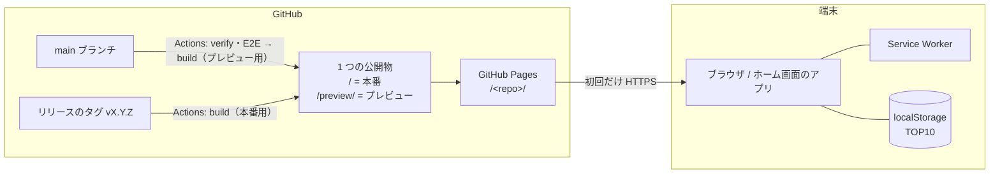

# 最終防衛線ミニ システム構成（初版）

`docs/spec/ARCHITECTURE-TEMPLATE.md`（以下「テンプレート」）の構成をそのまま使う。この文書には、**テンプレートと違うところ** と **このアプリで決める値** だけを書く。細かい設計（画面・入力の割り当て・敵の動き）は、PBI ごとにスプリントの中で作る（先回りしない）。

## 1. 前提（テンプレート §1 のまま）

- 静的な PWA。GitHub Pages から配り、一度読み込んだら通信しない。
- 外部の CDN・Web フォント・サーバー・BaaS は使わない。ランキング（TOP10）は localStorage に保存する（オンラインは作らない。IDK 問い 4）。
- 対象の端末：PC（Chrome・Edge）、iPhone（Safari・ホーム画面のアプリ。実機は iPhone 11）。Android は手元にないため確かめない（IDK Q4）。

## 2. 全体像（テンプレート §2 との違い：公開先が 2 つ）

GitHub Pages は 1 つのリポジトリに 1 つの公開物しか置けない。そこで公開のワークフローで、**最新のリリースのタグ（本番）と main（プレビュー）を両方 build して 1 つにまとめて** 公開する（ADR にする。最初のスプリントで作る）。

| | 本番 | プレビュー |
| :--- | :--- | :--- |
| URL | `https://<user>.github.io/<repo>/` | `https://<user>.github.io/<repo>/preview/` |
| 何を公開するか | 最新のリリースのタグ | main の最新 |
| 公開のきっかけ | PO の「リリースしてください」→ タグ | PR のマージ |
| アプリ名（ホーム画面） | 最終防衛線ミニ | 最終防衛線ミニβ（アイコンの色も変える） |
| アプリ識別子 `<app-id>` | `last-line-mini` | `last-line-mini-preview` |
| 保存のキー・SW のキャッシュ | `last-line-mini-…` | `last-line-mini-preview-…` |

- 名前・識別子は build のときの設定（環境変数 `APP_CHANNEL=production|preview`）で切り替える。コードは同じ。
- **気をつけること**：本番の SW の範囲 `/<repo>/` は `/<repo>/preview/` を含んでしまう。本番の SW は `navigateFallbackDenylist` に `/preview/` を入れ、プレビューのページを扱わないようにする。E2E で確かめる。
- 本番のタグがまだないあいだ（最初のリリースまで）は、`/` に「準備中」のページだけを置く。

## 3. 層と依存の向き（テンプレート §3 のまま）

| 層 | このアプリで持つもの |
| :--- | :--- |
| core | 状態の更新（固定ステップ）、照準の慣性、迎撃ミサイル・爆風・誘爆、敵 5 種の動き、ウェーブの進行、CLEAR／GAME OVER の判定、点数とボーナス、TOP10 の差し込みと順位の決まり（§5.3 の同点の扱い） |
| render | 夜空・地形・基地・都市・敵・航跡・爆風・照準・HUD・演出をドット絵で描く。文字は自前のビットマップフォント |
| storage | TOP10 の保存・読み込み（10 件まで、形の検査） |
| app | 画面の切り替え（タイトル・プレイ・結果・ネームエントリー・ランキング）、入力（キー・マウス・タッチ）、ループ、大きさ合わせ、PWA、テスト用の入口 |
| audio | **作らない**（効果音・BGM は IDK の「あとで決める」。決まったら層を足す） |

## 4. このアプリで決める値（初版。スプリントの中で直してよい）

| 項目 | 値 | 理由 |
| :--- | :--- | :--- |
| 論理の画面の大きさ | 480 × 640（縦長） | スマートフォンを縦に持って遊べる。PC では左右に余白を出す。最終は GUI で PO が決める |
| ステップの速さ | 120 ステップ／秒、1 回の描画で最大 12 ステップ | テンプレートと同じ（速い迎撃ミサイルでも当たり判定がすり抜けにくい） |
| 乱数 | 種から（mulberry32）。`?debug=1&seed=<整数>` で固定 | 同じ展開を再現してテスト・難しさの調整に使う（IDK 心配ごと④） |
| 画面の切り替え | `#/title`・`#/play`・`#/result`・`#/name-entry`・`#/ranking` | テンプレート §5.4 |
| テスト用の入口 | `window.__llm`（`getState`・`setState`・`freeze`・`advance`・`simulateUpdate`）、起動の知らせ `window.__llmBooted` | テンプレート §5.10 |

## 5. テンプレートから外すもの・あとで決めるもの

| もの | 扱い |
| :--- | :--- |
| audio 層・音の検査（check-dist） | 外す。音を作ると決めたら足す |
| 記録の JSON の書き出し・読み込み | あとで決める（iPhone でランキングが消える対策。IDK Q6 の答えしだいで PBI にする） |
| 設定の保存（settings-store） | 設定の画面が要ると決まるまで作らない |
| `check-docs.mjs` | 作る（TEAM 4.5。テンプレートの「SDD を使うとき」に当たる） |

## 6. 改訂履歴

| 版 | 日付 | 内容 |
| :--- | :--- | :--- |
| 0.1 | 2026-11-02 | 初版の案（IDK 問い 6 とテンプレートから） |
| 1.0 | 2026-11-02 | 承認 |
