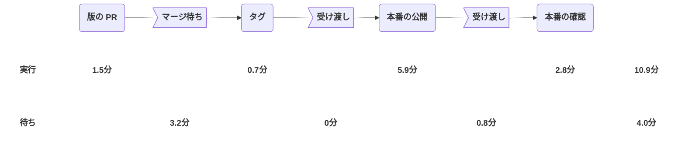

# スプリント 18 のバリューストリームマップ（VSM、2026-11-20）

対象：LLM-PBI-0023（タイトル画面で、プレイ中とは別の BGM が鳴る）が、リファインメントから受け入れまで流れた道すじ。続けて、v1.3.0 の本番の公開（リリース）も載せる。形は TEAM 6.1（工程と受け渡し・実行と待ち。TEAM v1.15 の初回）。
材料：スプリントバックログ sprint-18 の O・L・待ちの記録（K の種類つき）、`gh` の PR・CI・Pages の時刻。
中断（B5）：なし。② の始まりは #121 のマージを確かめた 14:38:34 とする（依頼 14:29 ごろ → PG-0004 を置く → #121 のマージまでは「（列）プロダクトバックログ」）。
「秒」のない時刻（ごろ）は質問の画面の前後で推し量った。

## 1. 図

```mermaid
flowchart LR
    %% ===== 1行目：工程と受け渡し =====
    P0[" "] ~~~ P1(② リファイン・計画) --- P2>③ を待つ列] --> P3(③ TASK を作る) --- P4>受け渡し] --> P5(④ PR・CI) --- P6>⑤ マージ待ち] --> P7(⑥ 公開) --- P8>⑦ を待つ] --> P9(⑦ 実機確認) --- P9a>差し戻し] --> P9b(手戻り：やり直し) --- P10>受け渡し] --> P11(⑧ AC の記録) --- P12>受け渡し] --> P13(⑨ 受け入れ) ~~~ P14[" "]

    %% ===== 2行目：実行 =====
    X0[実行] ~~~ X1[6.6分] ~~~ X2[" "] ~~~ X3[11.7分] ~~~ X4[" "] ~~~ X5[2.3分] ~~~ X6[" "] ~~~ X7[3.3分] ~~~ X8[" "] ~~~ X9[5.1分] ~~~ X9a[" "] ~~~ X9b[17.5分] ~~~ X10[" "] ~~~ X11[2.3分] ~~~ X12[" "] ~~~ X13[1.0分] ~~~ X14[32.4分]

    %% ===== 3行目：待ち（工程の下は、その工程の中の待ち） =====
    W0[待ち] ~~~ W1[3.0分] ~~~ W2[1.8分] ~~~ W3[" "] ~~~ W4[0分] ~~~ W5[" "] ~~~ W6[0.1分] ~~~ W7[" "] ~~~ W8[0.8分] ~~~ W9[" "] ~~~ W9a[0分] ~~~ W9b[1.7分] ~~~ W10[0分] ~~~ W11[0.1分] ~~~ W12[0分] ~~~ W13[" "] ~~~ W14[5.7分]

    classDef cell fill:none,stroke:none
    classDef label fill:none,stroke:none,font-weight:bold
    classDef blank fill:none,stroke:none,color:transparent
    class X1,X3,X5,X7,X9,X9b,X11,X13,X14,W1,W2,W4,W6,W8,W9a,W9b,W10,W11,W12,W14 cell
    class X0,W0 label
    class P0,P14,X2,X4,X6,X8,X9a,X10,X12,W3,W5,W7,W9,W13 blank
```

- 右端の合計（実行 32.4 分・待ち 5.7 分）には手戻りを入れない。手戻り（やり直し）は実行 17.5 分・待ち 1.7 分の **19.2 分**（TEAM 6.1）。
- 差し戻し：② 0 ／ ③ 0 ／ ④ 0 ／ **⑦ 1**（PC：「低音ということもあり、音がとても小さい音量に聞こえる」）／ ⑧ 0 ／ ⑨ 0

**リリース**（PO の決定 15:36:14 前）

## 2. 段階ごとの数字

| 段階 | 始まり → 終わり | LT | 人の作業 | 機械 | 待ち | 差し戻し（P） |
| :--- | :--- | :--- | :--- | :--- | :--- | :--- |
| ① 依頼 | 2026-11-20 14:29 ごろ（区切りのあと PO が依頼） | — | — | — | — | — |
| （列）プロダクトバックログ | 14:36:38（PB に入った PR #121）→ 14:38:34 | 約 2 分（その前に PG-0004・IDK v1.9 を作った 14:30〜14:36） | — | — | — | — |
| ② リファインメント・プランニング | 14:38:34 → 14:48:12（準備 OK 14:46:24） | 9 分 38 秒 | 約 6 分 40 秒（Claude：並び順の表・決めること・最初の 1 回目・PBI・TC・スプリントバックログ） | — | 約 3 分（PO の決定 5 回。決め直し 0 回） | 0 |
| （列）③ を待つ | 14:48:12 → 14:49:57 | 1 分 45 秒 | （計画の PR #122 を作った） | — | — | — |
| ③ TASK を作る（0063） | 14:49:57 → 15:01:40 | 11 分 43 秒 | 約 5 分 20 秒（Claude） | 約 6 分 22 秒（verify 2 回 58 秒、sound・pause の E2E 1 分 14 秒、E2E 全体 4 分 10 秒） | 0（PO の決定なし） | 0（1 回目で通った） |
| ④ PR・CI（#123） | 15:01:40 → 15:03:59 | 2 分 19 秒 | — | 2 分 19 秒 | — | 0（1 回目で pass） |
| ⑤ マージ | 15:03:59 → 15:04:06 | 7 秒 | — | — | 7 秒（#122 は 15:02:22 にマージ） | 0 |
| ⑥ 公開 | 15:04:06 → 15:07:26 | 3 分 20 秒 | — | 3 分 20 秒 | — | 0 |
| （⑥→⑦）依頼の用意 | 15:07:26 → 15:08:11 | 45 秒 | 45 秒（Claude が番号を読み取り・表） | — | — | — |
| ⑦ 実機確認（1 回目） | 15:08:11 → 15:13:18 | 5 分 07 秒 | 約 5 分（PO。「NG がある」→ 聞き直し → 中身） | — | — | **1：「低音ということもあり、音がとても小さい音量に聞こえる」** |
| 決め直し・③' TASK を作る（0066） | 15:13:18 → 15:21:46 | 8 分 28 秒 | 約 2 分 40 秒（Claude）・約 1 分（PO の決定 2 回：直し方・v1.1 の承認） | 約 4 分 47 秒（verify 2 回 45 秒・E2E 全体 4 分 04 秒） | 1 分 01 秒（直し方の答えまで） | 0 |
| ④' PR・CI（#124）・⑤' マージ | 15:21:46 → 15:24:42 | 2 分 56 秒 | — | 2 分 49 秒 | 7 秒 | 0 |
| ⑥' 公開 | 15:24:42 → 15:27:38 | 2 分 56 秒 | — | 2 分 56 秒 | — | 0 |
| （⑥'→⑦'）依頼の用意 | 15:27:38 → 15:28:10 ごろ | 約 32 秒 | 約 32 秒（Claude） | — | 約 32 秒（数えるのは待ち） | — |
| ⑦' 実機確認（2 回目） | 15:28:10 ごろ → 15:32:28 | 約 4 分 18 秒 | 約 4 分 18 秒（PO：PC 1 回・iPhone 1 回） | — | — | 0 |
| ⑧ AC の記録 | 15:32:28 → 15:34:54 | 2 分 26 秒 | 約 1 分 47 秒（Claude） | 約 32 秒（CI） | 7 秒（オーナーのマージ。TC を含むので記録の PR にならなかった） | 0 |
| ⑨ 受け入れ | 15:34:54 → 15:35:52 | 58 秒 | 約 30 秒（Claude：結果・3 役の所感）・約 30 秒（PO） | — | — | 0 |
| リリース（版の PR → 本番の確認） | 15:36:14 → 15:51:05 前 | 約 14 分 51 秒 | 約 2 分（Claude）・約 3 分 30 秒（PO：マージ・タグ・本番の確認） | 約 5 分 53 秒（本番の公開） | 3 分 15 秒（#126 のマージ待ち）・約 47 秒（本番の確認の表） | 0 |

## 3. まとめ

| 見方 | 値 |
| :--- | :--- |
| ② の始まり → 受け入れ | **57 分 18 秒**（スプリント 17 は 30 分 01 秒、16 は 55 分 29 秒） |
| 実行の合計（手戻りを除く） | 32.4 分 |
| 待ちの合計（手戻りを除く） | 5.7 分 |
| 手戻りの長さ | **19 分 10 秒**（33%。差し戻し 15:13:18 → やり直しの確認 OK 15:32:28） |
| 流れの効率（実行 ÷（実行＋待ち＋手戻り）） | **57%**（スプリント 17 は 91%） |
| そのうち PO の作業・決定 | 約 13 分 20 秒（約 23%。② の決定 約 3 分・実機確認 2 回 約 9 分 20 秒・直しの決定 約 1 分） |
| そのうち Claude の作業 | 約 17 分 30 秒（約 31%） |
| そのうち手元の機械（E2E・verify） | 約 11 分 10 秒（約 19%） |
| そのうち CI・公開 | 約 11 分 30 秒（約 20%） |
| 準備 OK → 受け入れ（F） | 49 分 28 秒（14:46:24 → 15:35:52。スプリント 17 は 24 分 36 秒） |
| 着手 → 受け入れ | 45 分 55 秒 |
| 依頼 → 本番 | 約 1 時間 18 分（14:29 ごろ → 15:47:32） |
| リリースの決定 → 本番の確認 OK | 約 14 分 51 秒 |

## 4. 図から見えること（レトロの材料）

1. **いちばん長いのは手戻り（19 分 10 秒、全体の 33%）**。手戻りを除けば約 38 分で、③ の 11.7 分がいちばん長い実行。待ちは 5.7 分と小さい。
2. **差し戻しの原因は「聞こえ方」**：低い音は同じ強さでも小さく聞こえる。数値の設計（高さ・速さ・強さ）では決められず、E2E の `data-bgm` も「鳴らすと決めた曲」しか見ないので、実機の 1 回目まで誰も聞いていなかった。画面のモック（案 18）にあたる「音の試し聞き」がなかった。
3. **直しは速かった**：決め直しから確認 OK まで 19 分。E2E は 0063・0066 とも 1 回目で通り（案 30）、公開・依頼の用意も 1 分未満の待ちで回った。
4. **AC の PR が記録の PR にならなかった**：TC-0023 の版を #124 で上げ忘れ、AC の PR に `docs/05-test/` が入って、オーナーのマージが 1 回増えた（7 秒で済んだ）。
5. 実機確認は PC で「NG がある」だけが先に届き、聞き直しが 1 回あった（B4）。選択肢に「どこが」を書いてもらう欄がなかった。
